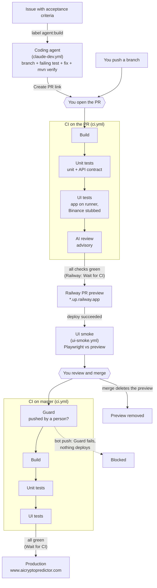

# AI Cryptocurrency Analysis Platform 🤖

A _experimenal_ AI-powered cryptocurrency analysis and predeiction platform that uses real-time market data and WEKA machine learning for price predictions for 4 cryptocurrencies - BTC, SOL, TAO and WIF. A work in progress.


📊 Live- https://aicryptopredictor.com/

### Features 
🔍 **Multi-timeframe Analysis**: Simultaneous analysis using ML across 1D, 1W and 1M timeframes.

📊 **Real-time Market Data**: Live cryptocurrency prices from Binance WebSocket feeds.

📈 **Interactive Charts**: Candlestick charts with timeframe selection and historical prediction overlays.

⚡ **Real-time Updates**: WebSocket-based live data streaming and analysis.

🧪 **Backtesting & Accuracy Audit**: 
- **Visual Backtest**: View historical AI predictions plotted directly on the price charts.
- **Color-coded Performance**: Green/Red segments clearly identify successful vs. failed directional predictions.
- **Audit Logs**: Deep-dive into historical evidence tables with win rates and average error metrics.
- **Automated Refresh**: Backtest results are refreshed every 6 hours and on system startup.

###  ML Pipeline:
Raw Price Data >  15 Technical Indicators > Feature Vector [SMA5, EMA12, RSI14, MACD, ...] > Weka ML Model Training (3 algorithms) > Real-time Price Predictions with Confidence Scores

### ML uses these features to predict price:
- **Trend Analysis**: SMA(5,20,50,200), EMA(12,26)
- **Momentum**: RSI(14), MACD, Price Acceleration  
- **Volatility**: Standard Deviation, Z-Score, Bollinger Bands
- **Volume**: Volume-Price Trend, Volume Strength
- **Market Structure**: Support/Resistance, Market Cycles

### Models Trained:
- **Automated Model Selection**: System trains Linear Regression, SVM, and Random Forest
- **Best Model Per Timeframe**: Selects highest-performing model (based on R² score) for each timeframe
- **Single Model Prediction**: Uses only the best model for actual price predictions

**Known Limitations:**
- ML models trained on limited historical data (from 2019)
- No backtesting framework implemented
- Basic feature engineering (15 indicators)
- Real-time predictions may lag during high volatility

### Prediction Timeframes:
- 1 day, 1 week, 1 month


⚠️ **This is an experimental project**: Predictions should not be used for actual trading decisions.


### Delivery pipeline

Every change, whether written by you or by the coding agent, takes the same path to production. Each box is a GitHub Actions job, a Railway step or a decision you make; the three workflows are linked by events.



- **Backtest** (live data) is a manual extra on the CI workflow: Actions → CI → Run workflow → tick "run backtest".
- **UI tests run twice on a PR:** in CI against the app started on the runner with stubbed market data (fast, deterministic), then against the real Railway preview (proves the deployed build works).
- **Where to look:** a PR's checks and statuses show CI, the AI review, Railway and UI smoke together; the Actions tab lists each workflow's runs.

### Running tests

```bash
mvn -B verify              # offline unit tests + JaCoCo report (target/site/jacoco)
mvn -B verify -Pbacktest   # live-data backtest against Binance (slow, needs internet)
```

Tests use the `test` Spring profile (`src/test/resources/application-test.properties`), which switches off ML training, Binance WebSockets, startup preloads and scheduled jobs. External APIs are stubbed with WireMock. CI runs the same build on every pull request (`.github/workflows/ci.yml`).

### Admin endpoints

`POST /api/system/train`, `GET /api/backtest/run` and `/api/debug/**` require an `X-Admin-Token` header matching the `ADMIN_TOKEN` environment variable. If `ADMIN_TOKEN` is not set, they return 404.

### API docs

Swagger UI and `/v3/api-docs` are switched off by default so they are not published on the live site. To view them locally, run with `SPRINGDOC_API_DOCS_ENABLED=true SPRINGDOC_SWAGGER_UI_ENABLED=true` and open `/swagger-ui/index.html`.
